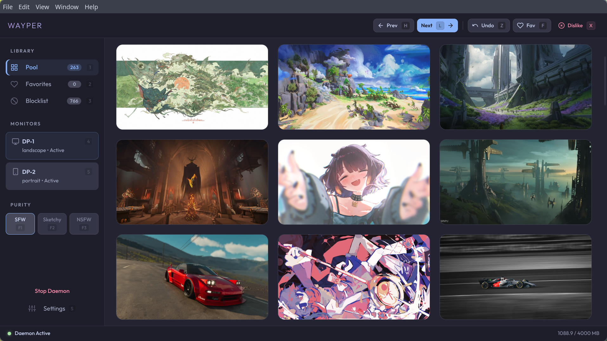
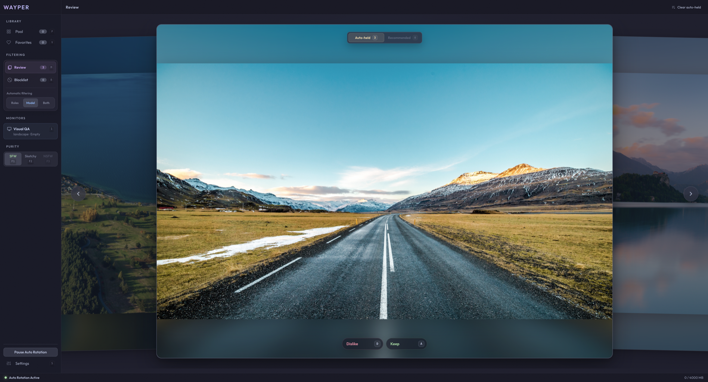
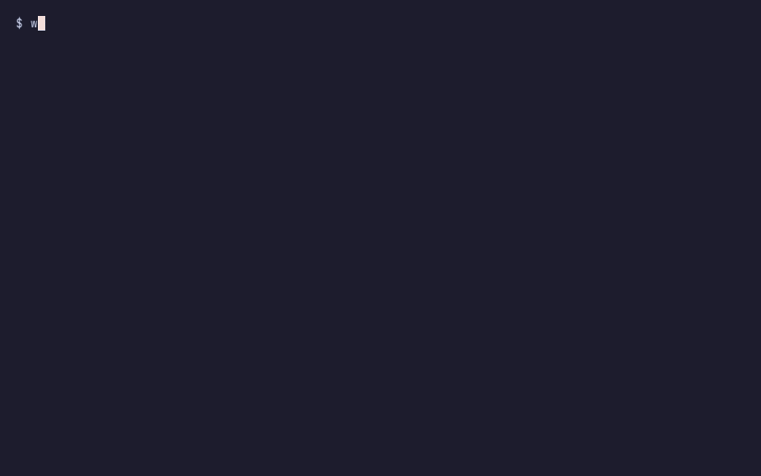

<p align="center">
  
  <h1 align="center">wayper</h1>
  <p align="center">
    越用越懂你的壁纸管理器。<br>
    Wallhaven 集成 · AI 辅助筛选 · 全键盘操作。
  </p>
  <p align="center">
    <a href="#安装">安装</a> · <a href="#gui">GUI</a> · <a href="#cli">CLI</a> · <a href="#配置">配置</a> · <a href="../README.md">English</a>
  </p>
</p>

<p align="center">
  <a href="https://github.com/yuukidach/wayper"></a>
  <a href="https://github.com/yuukidach/wayper/blob/main/LICENSE"></a>
  <a href="https://aur.archlinux.org/packages/wayper"></a>
  <a href="https://github.com/yuukidach/wayper/releases/latest"></a>
</p>

<p align="center">
  
</p>

## 为什么选 wayper？

大多数壁纸工具止步于"设置桌面图片"。wayper 是一个完整的 **Wallhaven 客户端**，自动下载、筛选、轮换壁纸——而且越用越懂你的口味。

**核心差异：**

- **越用越聪明** — 模型漏掉真正不喜欢的壁纸时，用 **Dislike（不喜欢）** 明确教给模型；**Ban（拉黑）** 则保留为“看腻了”的单图屏蔽，两者互不混淆。
- **规则建议** — 本地统计会列出在你屏蔽的壁纸中出现最多的标签、标签组合和上传者，并标出其中有多少被你保留。一键排除后，新的下载会跳过它们。
- **全键盘操作 GUI** — 每个操作都有快捷键。网格导航、灯箱预览、收藏、设置——完全不需要鼠标。为重度用户打造。

**基础能力：**

- **Wallhaven 集成** — 直接在 GUI 中浏览和搜索 Wallhaven，按查询自动下载，并将收藏和标签黑名单同步到账号。
- **智能标签过滤** — 排除标签自动同步到 Wallhaven 云端黑名单（服务端过滤）；溢出的标签通过 URL 参数发送；剩余的在元数据获取后本地过滤。零浪费下载。
- **自动匹配方向** — 竖屏显示器自动用竖屏壁纸，无需分类。
- **三档纯度** — SFW、Sketchy、NSFW 独立开关，跨会话持久化。
- **跨平台** — Windows、macOS 和 Linux（Hyprland/Sway）。CLI + GUI。
- **图库管理** — 保留并校验下载原图，再进行轮换，内置收藏、黑名单与历史前后导航。
- **`--json` 全覆盖** — 所有命令支持机器可读输出。

## 安装

### Arch Linux (AUR)

```bash
paru -S wayper     # 或: yay -S wayper
```

### Windows

从 [GitHub Releases](https://github.com/yuukidach/wayper/releases/latest) 下载最新版 Windows 安装包。

### macOS

从 [GitHub Releases](https://github.com/yuukidach/wayper/releases/latest) 下载最新版 `.dmg`。

### 从源码安装

Wayper 是一个基于 Electron 的单体 TypeScript 应用，不需要另外安装后端。
构建需要 Node.js 24 或更新版本和 npm。

```bash
git clone https://github.com/yuukidach/wayper.git
cd wayper
npm ci
npm run build
npm link            # 把 `wayper` 放进 PATH
wayper              # 打开应用；`wayper --hidden` 启动到托盘
```

安装好的应用本身就是 CLI：`wayper next`、`wayper status --json` 以及下文的其他命令都由同一个可执行文件提供，
并且不需要图形环境。

Wallhaven 账号同步使用你保存的账号密码登录。遇到 Cloudflare 验证时，Wayper 会打开自带的登录窗口，
不需要浏览器扩展或导出 Cookie。

## GUI

<p align="center">
  <strong>浏览</strong><br>
  
</p>

`wayper` 启动托盘常驻应用，用于浏览、管理和控制壁纸集合。完全支持键盘操作，无需鼠标。原有命令行子命令继续可用，`wayper-gui` 保留为兼容别名。

<p align="center">
  <strong>待确认</strong><br>
  
</p>

在「待确认」中检查模型自动拦截的下载和推荐图片。对每张图片选择「保留」或「不喜欢」可优化本地筛选；也可以清空自动拦截项而不让模型学习。

- **浏览与预览** — 网格浏览（缩略图缓存）、灯箱预览、Enter 设为壁纸
- **标签搜索** — 按 Wallhaven 标签、分类或文件名搜索，支持自动补全
- **智能建议** — 分析拉黑模式，推荐要排除的标签；共现挖掘找出跨排除个体的共同描述符；支持组合排除（如"tattoo + nude"）精细过滤
- **偏好筛选** — 可通过顶栏的显示选项菜单选择仅用规则、仅用偏好模型或两者结合。**待确认** 页面分别展示模型自动拦截的下载和建议检查的图库图片；清空 Auto-held 会过滤整条队列，但不会增加偏好标签
- **后台自动换壁纸** — 关闭窗口后 Wayper 仍驻留系统托盘，可切换壁纸、暂停自动更换、重新打开窗口或完全退出
- **设置** — 在 GUI 中配置下载目录、Wallhaven 查询、排除标签/组合、内容级别和显示器；修改会即时生效
- **固定登录背景（Linux）** — 配置 `[greeter].image` 后，打开壁纸预览并点击「登录背景」。Wayper 会将所选图片复制到登录背景文件，并停止随机更换登录背景；桌面壁纸仍按原设置轮换
- **全键盘操作** — 每个操作都有快捷键：网格导航、灯箱、收藏、不喜欢、拉黑和撤销

使用 `wayper --hidden` 可直接启动到托盘。Hyprland 或 Sway 的托盘由 Waybar 等状态栏提供，请确保已启用其 `tray` 模块。

如果窗口与后台服务失去连接，再次启动 Wayper 即可。现有应用会检查连接，必要时重启自己启动的后台服务，再刷新窗口。启动错误对话框中的「重试」也会重启后台服务。单独启动的后台服务需先在原终端停止，再重试。

**网格浏览：**

| 按键 | 操作 | 按键 | 操作 |
|------|------|------|------|
| `1` / `2` | 壁纸池 / 收藏 | `3` / `4` | Review / 黑名单 |
| `s` | 设置 | `F1` `F2` `F3` | 切换 SFW / Sketchy / NSFW |
| `h` / `l` | 上一张 / 下一张壁纸 | `f` | 收藏 |
| `d` | 不喜欢 + 教给模型 | `x` / `Del` | 仅拉黑这张图 |
| `u` | 撤销上次不喜欢 / 拉黑 | `o` | 在 Wallhaven 打开 |
| `/` | 聚焦搜索栏 | `Esc` | 清除搜索 / 取消聚焦 |
| `Enter` / `Space` | 预览（灯箱） | 方向键 | 网格导航 |
| `[` / `]` | 黑名单：上一个 / 下一个标签页 | `Shift`+`1`–`9` | 切换显示器 |
| `g` | 定位当前壁纸 | `gg` / `G` | 跳到第一张 / 最后一张 |
| `F4` | 打开显示选项（分级、过滤策略、卡片密度、画框、存储） | `?` / `Ctrl`+`K`（`⌘K`） | 命令面板 |

**待确认：**

| 按键 | 操作 |
|------|------|
| `Tab` / 方向键 | 进入待确认区并在候选图片间移动 |
| `Enter` / `Space` | 预览当前候选图片 |
| `←` / `→` | 在待确认预览中切换候选图片 |
| `a` / `d` | 保留 / 标记当前候选图片为不喜欢 |

**灯箱预览：**

| 按键 | 操作 | 按键 | 操作 |
|------|------|------|------|
| `←` / `→` | 上一张 / 下一张（缩放时为平移） | `Enter` | 设为壁纸 |
| `f` | 收藏 | `d` | 不喜欢 + 教给模型 |
| `x` / `Del` | 仅拉黑这张图 | `a`（Review） | 保留预览中的候选图 |
| `o` | 在 Wallhaven 打开 | | |
| `Space` / `Esc` | 关闭灯箱 | | |
| 滚轮 | 在光标位置缩放（0.5×–8×） | 拖拽 | 缩放时平移 |
| `0` | 重置为适应窗口 | `+` / `-` | 放大 / 缩小 |
| 双击 | 100% / 适应窗口切换 | | |

## CLI

<p align="center">
  
</p>

```
wayper next                 # 下一张壁纸（历史前进或随机新壁纸）
wayper prev                 # 上一张壁纸（历史后退）
wayper fav [--open]         # 收藏当前壁纸
wayper unfav                # 取消收藏
wayper dislike              # 明确不喜欢：教给模型、拉黑并切换
wayper ban                  # 仅屏蔽这张图：拉黑并切换
wayper unban                # 撤销上次不喜欢或拉黑
wayper mode                 # 切换 sfw↔nsfw（保留 sketchy 状态）
wayper mode sketchy         # 开关 sketchy
wayper mode sfw,sketchy     # 设置精确组合
wayper suggest             # 基于频率的标签排除建议
wayper model train         # 训练轻量的本地元数据排序模型
wayper model score --tags "tag1,tag2"  # 解释本地“不喜欢”评分
wayper model status        # 查看已保存模型和近期验证结果
wayper metadata status     # 查看本地 Wallhaven 元数据完整度
wayper metadata backfill   # 可续跑地补齐图片和 tag 完整详情
wayper status               # 查看当前状态
wayper                      # GUI 应用 + 托盘后台自动换壁纸
wayper setup                # 安装 .desktop（Linux）
wayper --json status        # JSON 格式输出
```

排除建议和 tag/上传者统计使用持久化的屏蔽历史与最新反馈，而不只读取当前黑名单。撤销屏蔽、保留和收藏
会覆盖旧的屏蔽记录。保留证据来自仍在图库/收藏中的文件或明确的保留/收藏反馈；仅剩元数据的缺失文件、
模型暂存和未标注的批量清空都不会被当作正向或负向反馈。收藏仍会阻止扩大排除范围，原有建议阈值不变。

`wayper model train` 只根据本地 Wallhaven 元数据（规范化 tag、颜色/分类/纯度）训练，
不会打开图片或读取像素。FastEmbed 随 Wayper 安装；首次使用时会下载并缓存
`BAAI/bge-small-en-v1.5` tag 模型，用于提供语义路径。
每条明确的 Keep/Dislike 都会保留在 KNN 邻居库中：先用 IDF 加权 pooled embedding 矩阵粗召回，
再只对候选结合精确 tag 重合、逐 tag MaxSim、分类/颜色/纯度上下文和平衡的 Keep/Dislike 证据细排。
全局 sparse+dense 分类头最多拟合 2,048 条类别均衡的工作样本，在各纯度间分配名额，并在每种纯度内
优先选取近期反馈，但不会截断 KNN 的历史记忆。最终决策从内部留出集学习局部对比投票与全局偏好概率
的融合权重；随后使用最多 640 条独立决策校准出的单一阈值，目标精确率不低于 80%。留出集按标签和
纯度分层抽样，避免近期集中审阅 SFW 时挤掉 NSFW/Sketchy 的反馈。embedding 只来自元数据并缓存在本地。
新下载会保存 Wallhaven 的完整 tag 对象；旧的活跃及模型相关记录可通过
`wayper metadata backfill` 在遵守 API 限速的前提下补齐。

在还没有 **Review** 反馈时，Wayper 可以暂时用旧的黑名单/收藏数据启动。第一次 Review 决策或手动
**Dislike** 之后，新的训练标签只来自明确的 Keep/Dislike；**Ban** 仍只是单图拉黑。仅出现在图库中的图片
不会被当成「喜欢」。在明确的两类反馈和独立校准都可用前，模型过滤保持关闭。就绪后模型会学习相近的元数据，
把疑似拉黑项放入可恢复的队列并给出推荐；它不会自动修改黑名单，积累足够反馈后会在本地刷新。

打开 **Review** 来教模型。顶栏的显示选项菜单可为新下载选择 `Rules`、`Model` 或 `Both`（`Rules + model`）。
**Auto-held** 是被模型暂存的下载，**Recommended** 是图库中可能需要拉黑的图片，Auto-held 会优先显示。
左右按钮可切换卡片；`Enter`/`Space` 打开预览，`A` 保留，`D` 标记不喜欢。向左拖动卡片为保留、向右拖动为不喜欢，
与按键位置一致。保留 Auto-held
会把文件放回图库；保留 Recommended 只记录反馈，不移动文件。设置中的语言可以跟随系统，也可以切换为
English/简体中文；下载批量大小位于「常规」配置。**清空已拦截** 会将当前图库范围内的 Auto-held
图片加入黑名单，但不会记录 Keep 或 Dislike 反馈。

### 快捷键示例

**Hyprland：**

```ini
bind = $mod, F9,       exec, wayper ban
bind = $mod CTRL, F9,  exec, wayper dislike
bind = $mod SHIFT, F9, exec, wayper unban
bind = $mod, F10,      exec, wayper fav
bind = $mod SHIFT, F10,exec, wayper unfav
bind = $mod CTRL, F10, exec, wayper fav --open
bind = $mod, F11,      exec, wayper next
bind = $mod SHIFT, F11,exec, wayper prev
bind = $mod, F12,      exec, wayper mode
bind = $mod SHIFT, F12,exec, wayper mode sketchy
exec-once = wayper --hidden
```

**AeroSpace (macOS)：**

```toml
cmd-shift-n = 'exec-and-forget wayper next'
cmd-shift-b = 'exec-and-forget wayper ban'
cmd-shift-f = 'exec-and-forget wayper fav'
```

## 配置

Linux/macOS：

```bash
mkdir -p ~/.config/wayper
cp example-config.toml ~/.config/wayper/config.toml
```

Windows：

```powershell
New-Item -ItemType Directory -Force "$env:APPDATA\wayper"
Copy-Item example-config.toml "$env:APPDATA\wayper\config.toml"
```

壁纸下载目录和登录自启动可在 GUI 设置页修改，也可编辑 [`example-config.toml`](../example-config.toml)。自启动在所有平台上默认开启，还可通过 `wayper autostart enable|disable|status` 管理。Linux 使用图形会话级用户服务（无需再写 Hyprland `exec-once`），macOS 使用 LaunchAgent，Windows 使用当前用户的 Run 注册项。详见该文件的所有选项 — API key、代理、轮换间隔、配额、筛选策略、转场效果等。显示器会自动检测，`[[monitors]]` 配置段仅在检测失败时作为兜底。

Linux 下可在 **设置 → 基本设置 → 壁纸显示方式** 中选择 **裁剪铺满**（`crop`，默认）、**完整显示**（`fit`）、**拉伸铺满**（`stretch`）或 **原始尺寸**（`no`）。点击 **保存更改** 后，下次设置壁纸时生效；收藏或取消收藏时也会保留所选模式。也可在 `config.toml` 中设置 `[transition] resize`；缺失或无效的值会回退到 `crop`。Windows 和 macOS 上此控件不可用。

Linux 登录背景的 `[greeter].image` 应指向登录界面已经使用的背景文件。目标须可写，或现有 greeter sudo 配置允许复制。「登录背景」会保存独立副本，收藏、移动或删除原图都不会影响登录背景；登录界面下次加载背景时显示新图片。删除自动保存的 `[greeter].fixed_image` 配置项即可恢复随机更换登录背景。

## 依赖

- [Wallhaven API key](https://wallhaven.cc/settings/account)

**Linux：** [awww](https://codeberg.org/LGFae/awww)，以及
[Hyprland](https://hyprland.org/) 或 [Sway](https://swaywm.org/)。Wayper 会自动识别当前合成器，
并在两者上正确处理经过旋转的显示器尺寸。

**macOS：** 安装 `.dmg` 即可。

**Windows：** Windows 10/11。

**从源码安装：** Node.js 24+ 和 npm。

偏好模型在应用内本地训练和评分。首次训练会把一个小型文本嵌入模型（约 35 MB）下载到
`~/.cache/wayper/semantic`。由早期 Python 版本训练的模型会在新应用首次打开时于后台重新训练一次；
完成之前，模型不会过滤新下载的壁纸，**Review** 中显示“学习校准中”（英文界面为 **Calibrating**）。
运行 `wayper model train` 可立即重新训练。

## 许可

[MIT](../LICENSE)
